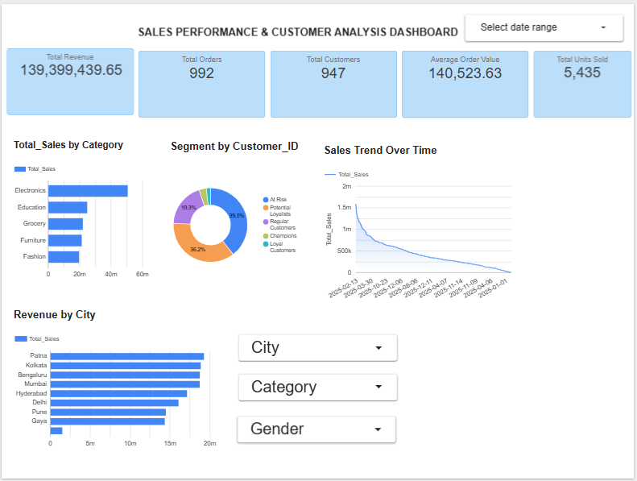

# ApexPlanet Task 3 – Sales Performance Dashboard

## Project Overview
This project is part of the ApexPlanet Internship Task 3. It focuses on Sales Performance Analysis and Customer Segmentation using RFM Analysis.

The project uses sales data to analyze business performance, identify important KPIs, and understand customer behavior through an interactive dashboard.

## Tools and Technologies
- Python
- Pandas
- NumPy
- Google Data Studio (Looker Studio)
- CSV

## Key Performance Indicators (KPIs)
1. **Total Revenue:** ₹139,399,439.65
2. **Total Orders:** 992
3. **Total Customers:** 947
4. **Average Order Value:** ₹140,523.63
5. **Total Units Sold:** 5,435

## Customer Segmentation using RFM Analysis

RFM stands for:
- Recency – How recently a customer made a purchase.
- Frequency – How frequently a customer purchased.
- Monetary – How much money a customer spent.

### Customer Segments
- At Risk: 374 customers
- Potential Loyalists: 343 customers
- Regular Customers: 183 customers
- Champions: 30 customers
- Loyal Customers: 17 customers

## Dashboard
**Live Dashboard Link:**

https://datastudio.google.com/reporting/146c68cc-e5c6-4d65-a8a8-41786d28b403

## Repository Files
- `customer_rfm.csv.csv` – Customer RFM analysis data
- `customer_segments_summary.csv` – Customer segment summary
- `dataset_profile.txt` – Dataset information
- `missing_values.csv` – Missing values analysis
- `dashboard_Preview.png` – Dashboard screenshot

## Conclusion
This project provides insights into sales performance and customer purchasing behavior. The interactive dashboard helps understand key business metrics and customer segments.
